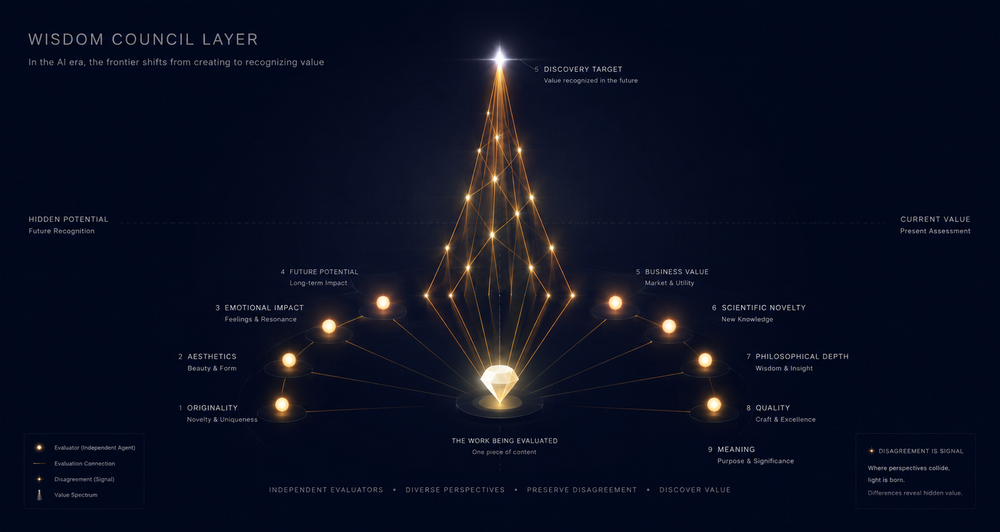

**语言:** [English](README.md) | [日本語](README-ja.md) | [中文](README-zh.md)

# Wisdom Council Layer

<p align="center">
  
</p>

**知恵の評議会（Wisdom Council Layer）** —— 从生成式 AI 的大量输出中，发现真正有价值之物的多智能体价值评估层。

## 为什么需要

生成式 AI 的发展，使文字、图像、音乐、代码、企划等一切创作物都能被大量生成的时代已经到来。

然而，新的问题也随之出现。

> **匮乏的已不再是“创造的能力”，而是“识破有价值之物的能力”。**

AI 能够生成平均且完成度高的输出。然而，真正重要的东西未必存在于平均之中。

- 乍看奇怪、却具革新性的东西
- 当下还无法被理解的东西
- 虽是少数派、却会创造未来文化的东西
- 改变人类认知的东西

**Wisdom Council Layer** 正是为了发现这些东西而构建的基础设施。

## 核心理念

- **Anti-Generic（反凡庸）**: 排除平均化的答案，发现有意义的偏离。
- **多声部评估（Polyphonic Evaluation）**: 不是单一的裁判，而是由持有不同视角的多个评估者进行合议。
- **分歧本身就是信号**: 评估者之间的对立不予平均化，原样保存。
- **评估重于生成**: AI 时代的竞争领域，从“能创造多少”转向“能识破多少有价值之物”。

## 分工（本仓库的定位）

> **本仓库为评估（Evaluation）而存在。作品的创作（Generation）在存在合适的其他手段时，交由那些手段处理。**

| 角色 | 负责方 |
|------|--------|
| **创作（Generation）** | 生成式 AI、专用的创作技能、其他工具（本仓库**不负责创作**） |
| **评估（Evaluation）** | 本仓库。从多视角评估已创作的内容，并为下一次创作备好材料（`weaknesses`・`improvement_suggestions`） |

**原则**: 将“创作者”与“评估者”分离，各自发挥专长。本层是评估的专家，**创作交由其他手段**。若无创作手段，则由人类接收评估结果并着手下一次创作。

## 架构

```
待评估的内容
        ↓
┌────────────── 知恵の評議会 (Wisdom Council) ──────────────┐
│  Originality  Aesthetic  Emotional        │
│  Anti-Generic Business   Scientific       │
│  Future       Philosophical  Meaning      │
│  Quality                                    │
└────────────────────────────────────────────┘
        ↓
  Value Vector（多维评分）
        ↓
  Disagreement Map（保存分歧）
        ↓
  Value Report（呈交人类决策者）
```

### 三层结构

```
Layer 1: Generation Layer（负责生成的 AI）※ 在本项目之外，交由合适的其他手段
Layer 2: Evaluation Layer（负责评估的 AI）← 本项目
Layer 3: Meta Value Layer（思考价值标准本身的 AI）← 未来阶段
```

**本项目只承担 Layer 2（评估）。** Layer 1（生成）交由生成式 AI、创作技能等合适的手段。

## 目录结构

```
wisdom-council-layer/
├── CLAUDE.md                          # 项目规范
├── install.sh                         # 全局/项目安装器
├── agents/                            # 评估者智能体的正本（10 位）
│   ├── originality.md
│   ├── anti-generic-filter.md
│   ├── aesthetic-critic.md
│   ├── emotional-impact.md
│   ├── future-potential.md
│   ├── business-value.md
│   ├── scientific-novelty.md
│   ├── philosophical-evaluator.md
│   ├── quality-evaluator.md
│   └── meaning-evaluator.md
├── skills/                            # 技能的正本（合议编排器）
│   └── wisdom-council/SKILL.md        # 合议编排器
├── .claude/agents/                    # 项目内检测用 symlink（评估者）
├── .claude/skills/                    # 项目内检测用 symlink（合议）
├── .claude-plugin/                    # 插件分发定义
│   ├── marketplace.json
│   └── plugin.json
├── schemas/
│   └── value-output.schema.json       # 全部评估者的输出契约
├── references/                        # 理论基础
│   ├── evaluator-taxonomy.md
│   ├── value-classification.md
│   ├── debate-principles.md
│   ├── value-vector-model.md
│   ├── scoring-strictness.md          # 严格评分基准
│   ├── calibration-suite.md           # 静态漂移检查＋运行时校准流程
│   └── runtime-calibration-runbook.md # 运行时校准执行手册（重启后）
├── examples/                          # 各类型样本（生成→评估→再创作）
│   ├── README.md
│   ├── creative-poem/                 # 诗
│   ├── creative-film/                 # 电影企划
│   ├── business-startup/              # 事业
│   ├── scientific-hypothesis/         # 科学假说
│   ├── cultural-philosophy/           # 思想随笔
│   ├── digital-oss/                   # OSS 软件
│   ├── architecture-house/            # 私人住宅设计（建筑）
│   ├── creative-watercolor/           # 图像生成提示词（水彩）
│   └── creative-photography/          # 图像生成提示词（摄影）
└── utils/
    ├── validate_output.py             # 输出验证（--json 可机器可读。合议的自动重试使用）
    ├── render_report.py               # 可视化（控制台 / Markdown）
    ├── compare_reports.py             # 修订前后的比较
    └── check_calibration_drift.py     # 对 en/ja/zh 智能体做静态漂移检查（权重・分数带・校准）
```

## 使用方法

### 安装

**全局（从任何地方都可调用）:**

```bash
./install.sh
```

会在 `~/.claude/agents/`（评估者智能体）和 `~/.claude/skills/`（合议技能）创建 symlink，使其可在任何项目中使用。

**仅限项目:**

```bash
./install.sh --local
```

**作为插件分发・安装**（在 GitHub 公开发布之后）:

```
/plugin marketplace add https://github.com/<你的账户>/wisdom-council-layer
/plugin install wisdom-council-layer@wisdom-council-layer
```

### 调用方式（3 个层级）

根据用途可从 3 个层级中选择。

| 层级 | 调用什么 | 返回内容 | 用途 |
|------|----------|----------|------|
| **1** | **1 位**评估者 | 单一维度的评估 JSON | 只想确认某个特定视角 |
| **2** | **合议（auto）** | 整合的 Value Report（3～5 个维度） | 根据领域高效地进行综合评价 |
| **3** | **合议（full）** | 填满全部 9 个维度的完整 Value Report | 从一开始就一次性评估全部视角 |

---

#### 层级 1：调用 1 位评估者

当只想评估特定视角时。评估者会以**子智能体**的方式启动。

```
Agent tool, subagent_type: originality
Prompt: {"content": "...", "content_type": "text", "domain": "creative"}
```

示例：
- 只确认企划的独创性 → 评估者智能体 `originality`
- 检查 AI 气息（凡庸性）→ 评估者智能体 `anti-generic-filter`
- 只确认市场性 → 评估者智能体 `business-value`

→ 返回内容：该评估者 1 位的 JSON（符合 `schemas/value-output.schema.json`，1 个维度 + 叙事）

> **以插件方式运行时**: 评估者以作用域名启动（例：`wisdom-council:originality`）。在项目内运行时，使用朴素名称（`originality`）即可。

---

#### 层级 2：调用合议（推荐）

当希望从多个视角进行综合评价时。合议判定领域，**选出 3～5 位评估者进行独立评估**，并返回整合的 Value Report。

```
Skill: wisdom-council
Args: {"content": "...", "content_type": "text", "domain": "creative"}
```

合议执行的流程：

```
评估对象
   ↓
领域判定 → 选择 3～5 位评估者（originality 与 anti-generic-filter 始终包含）
   ↓
独立调用各评估者（在不知道彼此结果的情况下评估）
   ↓
合成 Value Vector（平均值・方差・范围）
   ↓
生成分歧图（保存分裂的维度与双方的主张）
   ↓
输出 Value Report（分类・建议・各评估者的全文）
```

→ 返回内容：整合的 Value Report（多维度的评分分布 + 分歧 + 4 象限分类 + 建议）

---

#### 层级 3：一次性调用全部评估者

当希望从一开始就站在所有视角评估时。以 `mode: "full"` 调用合议，**全部 10 位将一次性独立评估**，并返回填满全部 9 个维度的完整 Value Report。

```
Skill: wisdom-council
Args: {"content": "...", "content_type": "text", "domain": "creative", "mode": "full"}
```

合议执行的流程（full 模式）：

```
评估对象
   ↓
召集全部 10 位（mode: full）
   ↓
独立调用各评估者（在不知道彼此结果的情况下评估）
   ↓
合成 Value Vector（填满全部 9 个维度）
   ↓
生成分歧图（保存分裂的维度与双方的主张）
   ↓
输出完整的 Value Report（分类・建议・各评估者的全文）
```

→ 返回内容：整合的 Value Report（**填满全部 9 个维度**的 Value Vector + 分歧 + 4 象限分类 + 建议）

> **提示**：也可以逐位单独调用各评估者（重复层级 1），但使用 `mode: "full"` 只需一次调用即可获得相同结果。`mode: "auto"`（层级 2）会根据领域选择 3～5 位，因此未被召集的维度为 `null`。

---

### 输出验证

```bash
python utils/validate_output.py < evaluator_output.json
python utils/validate_output.py --json output.json   # 机器可读的结果（合议的自动重试使用）
```

合议技能使用此验证器对每位评估者的输出进行确定性验证，不合格则**最多重试 3 次**。重试后仍失败的评估者会被明确记录到 `excluded_evaluators`（不静默丢弃）。

### 结果可视化

当 JSON 形式不易阅读时，可用渲染器转换为可视化显示。

**控制台显示:**
```bash
python utils/render_report.py < report.json     # 从 stdin 读取
python utils/render_report.py report.json        # 从文件读取
```

**Markdown 输出（整理为易读的文档）:**

```bash
python utils/render_report.py report.json                          # 控制台显示（条形图）
python utils/render_report.py report.json -o report.md             # 保存为 MD 文件（根据扩展名自动判定）
python utils/render_report.py --format md report.json              # 输出 MD 到标准输出
python utils/render_report.py --individuals report.json            # 同时显示全部评估者的个别报告
```

**MD 输出的机制**: 当**输出扩展名为 `.md`** 时（如 `-o report.md`），会自动转为 Markdown 格式。也可以使用 `--format md` 明确指定。生成的 MD 由标题、表格、引用构成，可在 GitHub / VSCode 预览中直接阅读。

MD 输出是**可在 GitHub / VSCode 预览中直接阅读**的格式（由标题、表格、引用构成）。实际示例: [examples/creative-poem/report.md](wisdom-council-layer/examples/creative-poem/report.md)

**输出示例**（渲染自 [examples/creative-poem/report-v2.json](wisdom-council-layer/examples/creative-poem/report-v2.json)）:

```
┌──────────────────────────────────────────────────────┐
│ 🧠 Wisdom Council Value Report
└──────────────────────────────────────────────────────┘

  分类: 🔍 Discovery Target（潜在价值）
  当前价值:  49  █████████████████░░░░░░░░░░░░░░░░░░░
  潜在价值:  59  █████████████████████░░░░░░░░░░░░░░░

【Value Vector】多维度评分（0-100，严格尺度）
  独创性 (originality)   ████████████████████████████░░  78
  品质 (quality)         ███████████████████████░░░░░░  65
  美学 (aesthetic)       ██████████████████████░░░░░░░  62
  情感 (emotional_impact) ████████████████████████░░░░░  68
  未来 (future_potential) ██████████████████░░░░░░░░░░  50
  商业 (business_value)  ██████░░░░░░░░░░░░░░░░░░░░░░░  18
  科学 (scientific_novelty) █░░░░░░░░░░░░░░░░░░░░░░░░░   5
  哲学 (philosophical_depth)█████████████████████░░░░░░  60
  意义 (meaning)         ███████████████████████░░░░░░  66

【跨维度对立（Contrast）】高评分轴与低评分轴共存 = 价值的紧张关系
  ⚡ 独创性(originality) 78  vs  商业(business_value) 18
  ⚡ 独创性(originality) 78  vs  科学(scientific_novelty) 5
```

渲染器会显示：
- **分类徽章**（🔍 Discovery Target（潜在价值）/ 🟢 Current Success（当前成功）/ 🔶 Trend Object（昙花一现）/ ⚪ Low Signal（暂无迹象）/ ⭐ Innovation（创新））
- **当前价值・潜在价值**的条形显示
- **9 个维度的 Value Vector** 条形图（严格尺度，条越长的越稀有的高分）
- **分歧**（评估者产生分歧的维度，附方差的严重程度）
- **跨维度对立**（高评分×低评分的紧张关系——不取平均，原样保存）
- **总评・共识点・建议行动・注意事项**

## 评估结果被设计为“输入”

本层的评估结果并非最终成果，而是**创作技能（专门合成再创作・改进指示的技能）的输入**。

合议并不直接生成再创作指示。取而代之，它把创作技能合成指示所需的**原始素材**以完整形式保留：

| 素材 | 在创作技能中的用途 |
|------|--------------------|
| `individual_reports[].weaknesses` | 弱点（附依据）——确定修改对象 |
| `individual_reports[].improvement_suggestions` | 各评估者的改进提案——指示的候选 |
| `individual_reports[].expected_disagreement_points` | 来自其他视角的反驳预测——用于平衡 |
| `disagreement_map` | 评估者产生分歧的维度——改进的线索 |
| `value_vector` | 全维度的评分分布——决定优先级 |

（专门合成再创作指示的技能的实现属于未来阶段。）

### 评估 → 再创作的循环

```
① 创作
    ↓
② 评估（wisdom-council / mode:full）
    ↓
③ 确认 revision_direction（下次修改方向）
    ↓
④ 创作技能以评估结果为输入合成指示 → 再创作
    ↓
⑤ 重新评估
    ↓
⑥ 比较（用 compare_reports.py 确认改进程度）
    ↓
⑦ 重复直到达成目标或进展停滞
```

**迭代模式（`iteration`）— 修改方向的管理:**

```bash
Skill: wisdom-council
Args: {"content": "...", "domain": "creative", "iteration": "confirm"}
```

| iteration | 行为 | 适用场景 |
|-----------|------|----------|
| `confirm`（默认） | 每轮评估后提示 `revision_direction`，**确认之后**再进行下一次修改 | 希望逐步检查方向调整 |
| `persistent` | 最初即确定 `revision_direction`，并沿该方向**持续修改** | 想确定方向后持续打磨 |

- `confirm` = 逐次确认模式（每轮都可以确认“朝哪个方向修改”）
- `persistent` = 方向固定模式（最初示明方向并持续执行）
- 详情: [references/revision-loop.md](wisdom-council-layer/references/revision-loop.md)

**改进程度的比较:**

```bash
python utils/compare_reports.py before.json after.json
```

输出示例:

```
🔍 分类: Discovery Target（无变化）

  【各维度改进】
  美学 (aesthetic)     62 → 75  ▲ +13
  品质 (quality)       65 → 72  ▲ +7
  意义 (meaning)       66 → 70  ▲ +4
  平均变化（9 个维度）: +3.8
```

**循环的指导原则:**
- **评估不丢弃原始数据**（合成的叙事只是辅助。素材保留在 JSON 中）
- 不要仅凭平均值判断，还要看**方差与分歧**（即使某个维度突出，整体也可能没有变化）
- 改进**停滞时停止循环**（过度修改有失去原有优点的风险）

## 评估者一览

10 位评估者均为**子智能体**（`agents/{name}.md`）。合议在彼此独立的上下文中启动它们，以保证评估的独立性。单独调用时，使用 Agent tool 启动（参见层级 1）。

| 评估者（智能体名称） | 核心问题 | 评分维度 |
|----------------------|----------|----------|
| Originality Evaluator（`originality`） | 是有意义的偏离，还是重新组合？ | originality |
| Anti-Generic Filter（`anti-generic-filter`） | 是否只是 AI 式的平均解？ | quality |
| Aesthetic Critic（`aesthetic-critic`） | 是否创造出深度的美学体验？ | aesthetic |
| Emotional Impact Evaluator（`emotional-impact`） | 能否打动人心？ | emotional_impact |
| Future Potential Analyzer（`future-potential`） | 在未来环境中价值会上升吗？ | future_potential |
| Business Value Evaluator（`business-value`） | 能否在市场创造价值？ | business_value |
| Scientific Novelty Reviewer（`scientific-novelty`） | 能否推动知识的前沿？ | scientific_novelty |
| Philosophical Evaluator（`philosophical-evaluator`） | 是否可能改变世界观？ | philosophical_depth |
| Quality Evaluator（`quality-evaluator`） | 技术上是否完成？ | quality |
| Meaning Evaluator（`meaning-evaluator`） | 是否赋予生命意义？ | meaning |

## Value Classification（价值分类）

以“当前价值 × 潜在价值”的二维矩阵进行分类。

```
             Hidden Potential
                  ↑
   Discovery Target   Innovation
────────────────┼──────────────────→  Current Value
   Low Signal        Current Success
```

合议的主要使命，是发现 **Discovery Target**（当前评价较低、但具有未来可能性的作品）。

## 路线图

- **Phase 1（已完成）**: Universal Evaluation Core — 10 位评估者智能体 + 合议编排器技能 + Value Vector + Value Report
- **Phase 2（未来）**: Hidden Potential Layer — Historical Analyzer, Mutation Detector, Timing Analyzer
- **Phase 3（未来）**: Debate Engine — 评估者之间的多轮辩论
- **Phase 4（未来）**: Meta Value Layer — Bias Detection, Evaluation Critic, Value Evolution

## 许可证

MIT License — Copyright (c) 2026 GL-Kageyama

## 核心宣言（Core Statement）

> AI 时代的竞争领域，
> 从“能创造多少”，
> 转向“能识破多少有价值之物”。

Wisdom Council Layer 正是为此而存在的价值发现基础设施。
